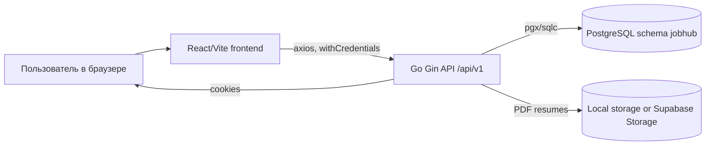
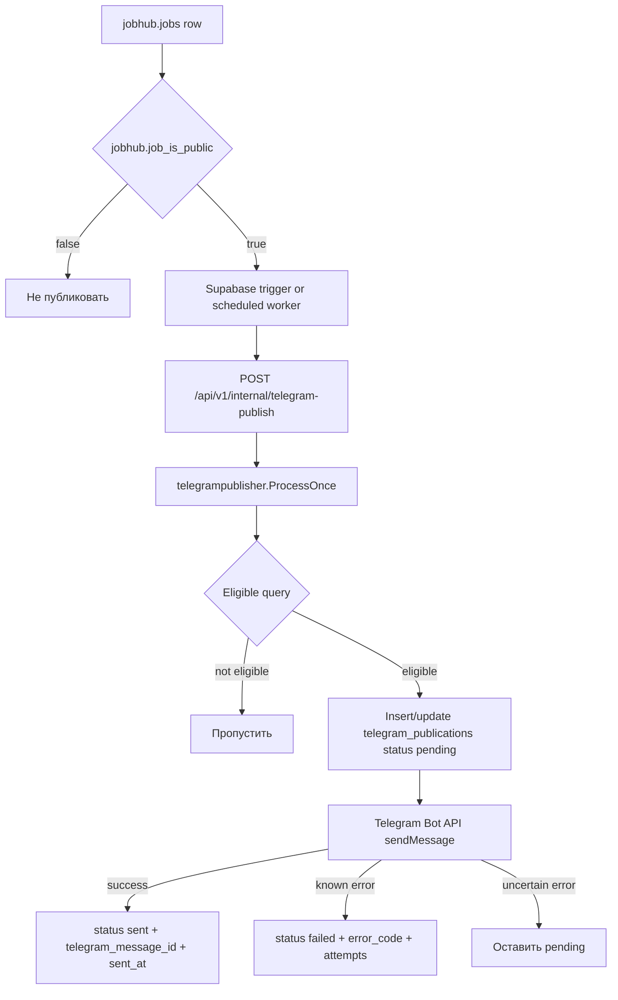

# Архитектура системы

## Основной поток данных

Подтверждено кодом:

- Frontend API base URL is configured in `frontend/src/lib/env.ts`.
- `frontend/src/api/client.ts` uses axios with `withCredentials: true`.
- Backend routes are registered in `backend/internal/handlers/router.go`.
- Database access is through pgx and sqlc-generated code under `backend/internal/database/dbgen`.
- Vercel routes `/api/(.*)` to backend service and all other paths to frontend service in `vercel.json`.

## Vercel services

| Service | Root | Public path | Notes |
| --- | --- | --- | --- |
| `frontend` | `frontend` | `/...` | Vite SPA; internal rewrite to `/index.html` |
| `backend` | `backend` | `/api/...` | Go service; Vercel top-level rewrite sends API traffic here |

No service binding is required for browser calls, because browser requests use the public `/api/v1` path.

## Telegram publisher flow

Eligibility is implemented in `backend/internal/telegrampublisher/store.go` and tests in `publisher_test.go`. The query requires:

- enabled source;
- confirmed source permission or explicit staging test opt-in;
- source provider not `demo`;
- `jobhub.job_is_public(j)` true;
- not created by demo employer email;
- not duplicated by canonical vacancy query;
- not already `sent` to the same `channel_id`;
- retry only when previous status is `failed`, attempts are below max and last update is older than one minute.

## Environments

| Environment | Подтверждено | Не подтверждено |
| --- | --- | --- |
| Local | `make dev`, `make local-up`, local frontend `5173`, backend default `8080`, local migrations through Docker Compose profile `local` | Exact developer machine DB state |
| Preview | Vercel supports preview by project settings, but repo only confirms `vercel.json` service routing | Separate preview database or secrets are not confirmed by code |
| Production | Vercel multi-service config, frontend public base URL used in docs/workflow, Supabase/PostgreSQL expected through env vars | Current live Vercel variables and Supabase secrets cannot be verified from repo without exposing secrets |

## Source code references

| Concern | Source |
| --- | --- |
| React routes | `frontend/src/App.tsx` |
| API client | `frontend/src/api/client.ts` |
| Frontend env | `frontend/src/lib/env.ts` |
| Backend router | `backend/internal/handlers/router.go` |
| Backend config | `backend/internal/config/config.go` |
| Vercel routing | `vercel.json` |
| Telegram webhook | `backend/cmd/api/telegram_webhook.go` |
| Supabase trigger SQL | `scripts/supabase-telegram-publisher.sql` |

