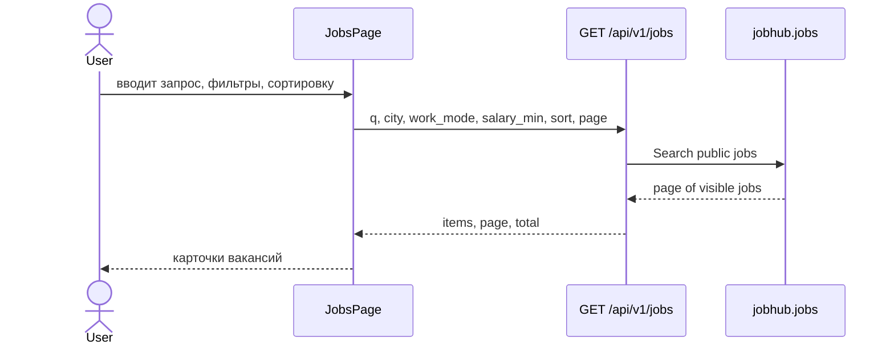
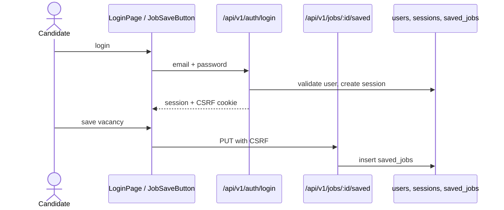
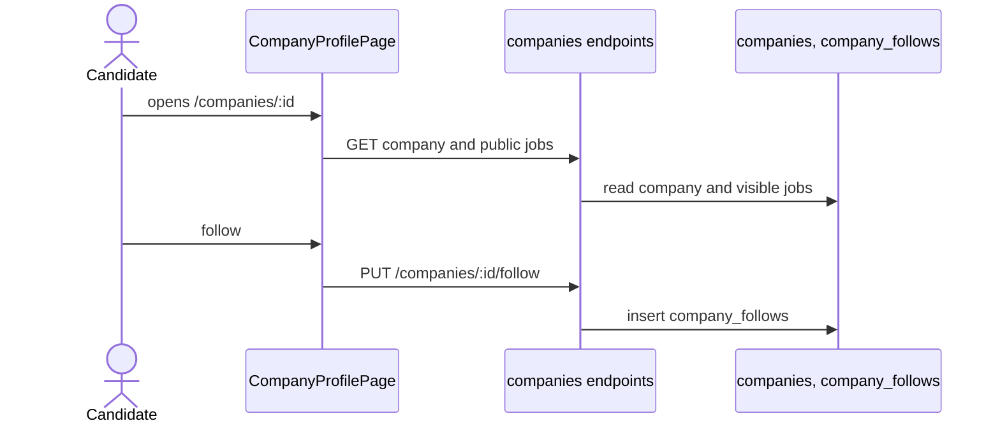
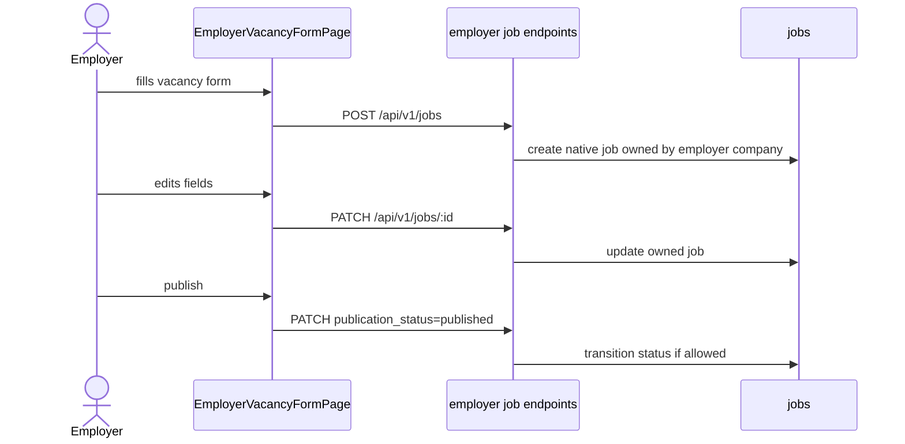
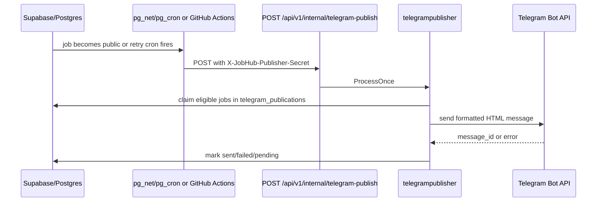

# Пользовательские сценарии

## Поиск вакансий

Компоненты: `JobsPage`, `JobSearchForm`, `JobFilters`, `SourceAwareJobRow`. Backend validates query parameters in `backend/internal/handlers/jobs.go`. Public visibility is enforced by store queries and the database function `jobhub.job_is_public`.

## Вход и сохранение вакансии

Save/unsave requires `job_seeker` role and CSRF header for mutations. If the user is a guest, frontend behavior depends on `JobSaveButton`; backend will reject unauthenticated requests.

## Компания и подписка

Public company page is available to guests. Follow state and follow/unfollow are confirmed only for authenticated `job_seeker`.

## Черновик, редактирование and публикация вакансии

Required backend fields for create/update include title, category, description, responsibilities, requirements, city, work mode, employment type and experience level. Transitions accept `draft`, `published`, `paused`, `closed`; invalid transitions return `409 INVALID_JOB_TRANSITION`.

## Telegram publishing

Confirmed publishing conditions are documented in [Telegram publisher](/docs/telegram-publisher-reference). Continuous work on Vercel is not guaranteed by an always-running API process: code explicitly disables background interval publisher when `VERCEL=1`; production-style execution is through webhook, Supabase SQL and/or GitHub Actions.

